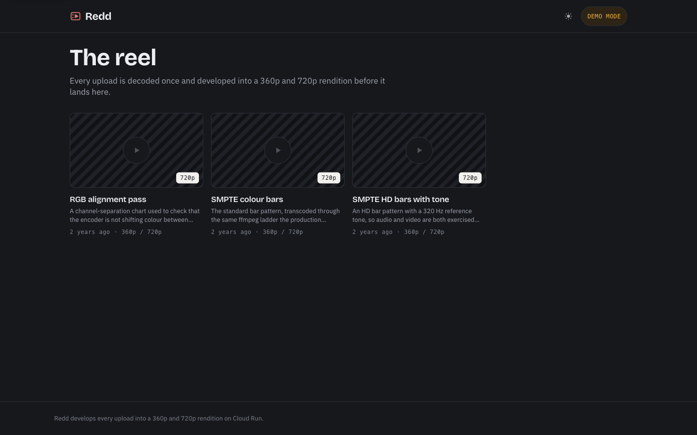
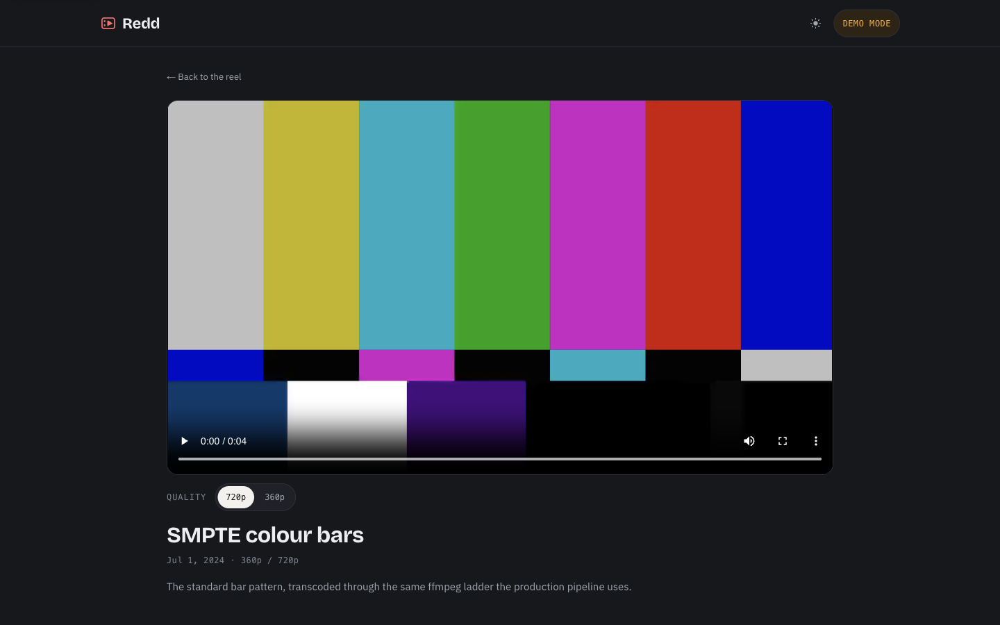
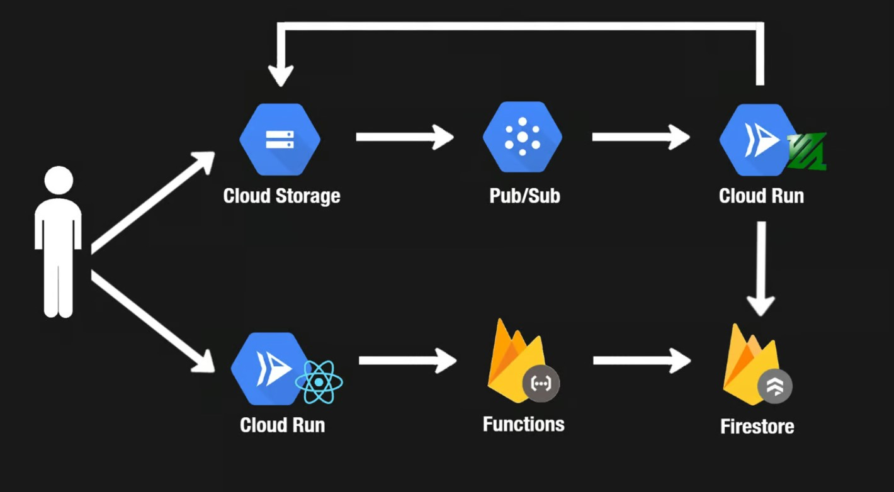

# Redd

A small video platform: upload a file, watch a machine develop it into a
360p/720p rendition ladder, then play it back. It is a working end-to-end
implementation of the hard parts of a video service — signed direct-to-storage
uploads, an event-driven transcoding pipeline, and exactly-once processing under
retries — rather than a UI mockup.

> **Status: offline prototype.** Nothing is hosted publicly. The repository is
> self-contained and runs on `npm install && npm run dev` with no cloud account,
> no API keys, and no configuration. See [Run it](#run-it).





---

## Run it

Requires **Node 24** (`.nvmrc` pins 24.19.0) and nothing else.

```bash
git clone https://github.com/Reddimus/youtube-clone.git
cd youtube-clone
nvm use            # or install Node 24 however you prefer
npm install
npm run dev        # http://localhost:3000
```

That is the whole setup. With no Firebase project configured the app starts in
**demo mode**: the feed is seeded from `yt-web-client/app/lib/demo-data.ts` and
the sample renditions in `yt-web-client/public/samples` are served by the app
itself, so video playback and the quality switcher genuinely work offline.
Sign-in and uploading are disabled and the header says so.

To run everything at once:

```bash
npm run check      # format, type-check, lint, test with coverage, build — all workspaces
npm test           # tests only
npm run build      # build every workspace
```

Connecting it to a real Firebase project is documented in
[`docs/setup.md`](docs/setup.md).

---

## What is actually interesting here

**The upload never touches a server.** The browser asks a Cloud Function for a
[signed V4 POST policy](yt-api-service/functions/src/index.ts), which binds the
content type, caps the body at 250 MiB, and expires in 15 minutes. The file goes
straight from the browser to Cloud Storage. No proxying, no server-side buffer of
a quarter-gigabyte upload.

**Processing is exactly-once under an at-least-once transport.** Pub/Sub redelivers
push messages after 600s, but a transcode may take much longer. The processor
resolves this with a
[Firestore transaction](video-processing-service/src/firestore.ts) that issues a
claim token with a 65-minute lease. A duplicate delivery for a video already
processed returns `204` (acknowledge, do nothing); one that is actively leased
returns `503` with `Retry-After`; a claim whose lease has expired is taken over.
Completion is a compare-and-set on the token, so a worker whose lease expired
mid-transcode cannot overwrite the result of the worker that replaced it.

**A malformed message is acknowledged, not retried.** A push message that cannot
possibly become valid — bad base64, wrong bucket, an unparseable object name —
returns `204` after logging. Returning an error would make it a poison message
that consumes the subscription forever.

**One decode, N encodes.** The transcoder
[probes the source height first](video-processing-service/src/storage.ts) and
emits only renditions the source can actually support, so a 360p upload is never
upscaled to 720p. The renditions it does emit come out of a single `ffmpeg`
invocation using `-filter_complex` with `split`, so the source is decoded once
rather than once per rendition. `ffmpeg` is invoked via `execFile` with a fixed
argument array — never a shell.

**The upload contract lives in one place.** The 250 MiB cap, the extension
allowlist, the content-type map, and the `u~<base64url uid>~<ms>~<uuidv4>.<ext>`
filename grammar are defined once in [`packages/contract`](packages/contract) and
imported by all three services. They used to be redeclared independently in four
places across three independently-deployed services, which meant changing the
size cap took four coordinated edits.

**Nothing leaks from the feed.** `toPublicVideo` is an explicit allowlist, so
`uid`, `claimToken`, and `status` cannot reach a client even if a new field is
added to the document later.

---

## Architecture



```
browser ──1── generateUploadUrl (Cloud Function)  ── signed POST policy
   │                                                       │
   └──2── signed multipart POST ──▶ redd-raw-videos (GCS) ◀──┘
                              │
                              3  object.finalize
                              ▼
                        Pub/Sub topic
                              │
                              4  push (OIDC)
                              ▼
              video-processing-service (Cloud Run)
                    claim ─▶ ffprobe ─▶ ffmpeg ─▶ upload ─▶ complete
                              │                       │
                              ▼                       ▼
                        Firestore videos      redd-processed-videos (GCS)
                              │
                              5  getVideos (Cloud Function, paginated)
                              ▼
                    yt-web-client (Next.js, server-rendered)
```

Full detail, including the failure modes each design decision addresses, is in
[`docs/architecture.md`](docs/architecture.md).

### Repository layout

| Path                                                   | What it is                                                                                                             |
| ------------------------------------------------------ | ---------------------------------------------------------------------------------------------------------------------- |
| [`packages/contract`](packages/contract)               | Upload/naming/rendition contract shared by every service. 100% statement coverage.                                     |
| [`yt-web-client`](yt-web-client)                       | Next.js 16 App Router front end. Server-rendered feed and watch pages, client islands for auth, upload, and playback.  |
| [`yt-api-service`](yt-api-service)                     | Firebase Functions: signed upload policies, the paginated public feed, and user creation. Firestore and Storage rules. |
| [`video-processing-service`](video-processing-service) | Cloud Run worker: claims a video, transcodes it with ffmpeg, uploads renditions, releases the claim.                   |
| [`utils`](utils)                                       | Bucket CORS and lifecycle policies.                                                                                    |

It is an npm workspace with a single root lockfile, so every package agrees on
one version of TypeScript, ESLint, Vitest, and Prettier.

---

## Tech stack

| Layer       | Choice                                                    |
| ----------- | --------------------------------------------------------- |
| Runtime     | Node 24 (Active LTS)                                      |
| Language    | TypeScript 6, `strict`, no `any`                          |
| Front end   | Next.js 16 (App Router), React 19                         |
| Styling     | CSS Modules + custom properties. No framework, no UI kit. |
| Auth        | Firebase Auth (Google)                                    |
| Data        | Cloud Firestore                                           |
| Storage     | Cloud Storage, signed V4 POST policies                    |
| Events      | Pub/Sub push with OIDC                                    |
| Compute     | Cloud Run, Firebase Functions v2                          |
| Transcoding | ffmpeg / ffprobe, invoked shell-free                      |
| Tests       | Vitest 4, Testing Library, supertest                      |
| Lint/format | ESLint 9 (flat, type-aware), Prettier 3                   |

---

## Tests

255 tests, all thresholds enforced in CI — a drop below them fails the build.

| Workspace                  | Tests | Statements | Branches | Functions | Lines |
| -------------------------- | ----: | ---------: | -------: | --------: | ----: |
| `@yt/contract`             |    94 |       100% |    95.8% |      100% |  100% |
| `@yt/api-service`          |    26 |      96.7% |    92.2% |      100% | 96.7% |
| `video-processing-service` |    48 |      98.9% |    94.7% |      100% | 98.9% |
| `yt-web-client`            |    87 |      93.0% |    88.3% |     86.0% | 93.3% |

The processor's suite includes integration tests over the real Express app with
every dependency injected, covering duplicate delivery, lease contention,
oversized and malformed bodies, ffmpeg failure, and the ordering guarantee that
temporary files are cleaned up _before_ the response is sent.

CI additionally builds both container images and asserts each one runs as a
non-root user and answers its health check.

---

## Design

The interface is built around making the pipeline legible. A video is not simply
absent until it is ready — it moves through **uploaded → developing → ready**,
which are the states the backend really records, and the feed and the upload
dialog both show that progression.

- Design tokens for colour, type, space, and motion; every colour is assigned a
  single job (brand, in-flight, ready, failed) rather than used decoratively.
- Light and dark themes with an explicit toggle layered over
  `prefers-color-scheme`, applied before first paint so there is no flash.
- WCAG AA contrast throughout, one focus treatment applied globally, full
  keyboard operability, `prefers-reduced-motion` respected.
- Feed and watch pages are server components, so markup arrives complete and
  each page carries its own title, description, canonical URL, and `VideoObject`
  JSON-LD. The Firebase auth SDK is dynamically imported and never downloaded by
  a visitor who only watches.

---

## Security posture

- Firestore and Storage rules deny all client SDK access; the collections are
  reachable only through the Admin SDK inside Cloud Functions and the processor.
  Rules and indexes are version-controlled here, not console-only.
- Uploads are bound by a short-lived signed policy with content-type and size
  conditions enforced by Cloud Storage itself.
- The processing endpoint expects a Pub/Sub push subscription authenticated with
  an OIDC service account holding only `roles/run.invoker`.
- No secrets in the repository. The Firebase _web_ config is public by design and
  read from the environment; service-account keys are gitignored everywhere.

Reporting and the current advisory exceptions are in [SECURITY.md](SECURITY.md).

---

## Licence

ISC. `docs/system-design.jpg` and the sample clips under
`yt-web-client/public/samples` are generated assets included for the demo.
